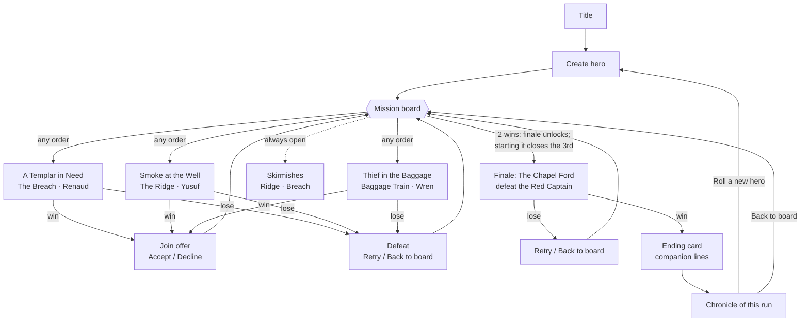

# Stage 2 mini-campaign: pitch (decided: Option B, built in v0.11)

> **Status (v0.11):** Cletus picked **Option B**. It is built with the recommended defaults for the other open decisions; what was built and which choices were defaults is in [DESIGN.md → Campaign](DESIGN.md#campaign-v011-open-board-finale-after-2). Below is the original pitch, kept for reference. Nothing here locks the story. Names, places and the finale are placeholders.
> **Purpose:** link the battles we already have into a short campaign, so the Stage 2 **Done when** can be tested end to end: create a hero → recruit companions from an FFTA2-style mission board → finale → *"do I want to roll a new hero?"* ([ROADMAP → Stage 2](ROADMAP.md#stage-2--core-loop-prototype)).
> Mockup: [`mockups/campaign-board.png`](mockups/campaign-board.png) (phone size; source `mockups/campaign-board.html`).

**Ground rules**
- **Reuse what's built:** the 3 recruit missions, their maps (The Breach, The Ridge, The Baggage Train), the board, Accept/Decline, squad of 3 (hero + 2). The only new content is **one finale battle** (plus maybe one map).
- **A light story thread, not the big story.** One raider band and one thing it wants. The thing it wants is a mythology door, not an answer. It ties into Wren's humming amulet and, later, Ingvar's sealed orders about a relic (companions pitch).
- **No stop-and-press.** Linking happens through the board, brief text, and who's in your squad. No dialogue trees, no quick-time choices, no new buttons in battle.
- **Playthroughs should differ:** which missions you take, in what order, and whom you bring to the finale.

---

## The thread (shared by both options)
A raider band under a captain nobody names (**"the Red Captain"**, placeholder) is hunting something carried in a Templar supply column: a sealed **reliquary**. Nobody says what's inside. Each recruit mission shows one piece of the band's hunt, and the finale is where it catches up with you.

| Mission (existing) | Map | Beat (1–2 lines) | Clue it gives / link onward |
|---|---|---|---|
| **A Templar in Need** → Renaud (Knight) | The Breach | Renaud was the reliquary's escort. The column was ambushed and he's been holding the old keep's breach so the drovers could run. | "They took the coast road with the carts." → points at **the Baggage Train** |
| **Smoke at the Well** → Yusuf (Scout) | The Ridge | Yusuf turned on his own band when the Captain ordered the drovers killed "for a box of bones". They're cutting him down for it. | "He'll make for the chapel at the ford: holy ground, he thinks it's needed to open the box." → points at **the finale** |
| **Thief in the Baggage Train** → Wren (Scout) | The Baggage Train | The raided column. Wren got to the carts first, and the clay amulet she took off the reliquary's straps **hums**. | "It hums louder east. Toward the river." → points at **the finale** |
| **Finale: The Chapel Ford** | **new** (see below) | The Captain has the reliquary at a ruined chapel above a river ford and is waiting for something. You have to cross the river and take the hill. | Ends the thread with a question, not an answer: the box is empty, or it hums back at Wren's amulet (see finale). |

Each beat works in **any order**: the brief text has one line per clue already found (e.g. Smoke's brief adds *"Renaud says they went for the carts"* if you have Renaud). That's what makes Option B possible.

---

## Option A: Linear chain
The board opens with **one** recruit mission. Winning it unlocks the next, in a fixed order, and the finale unlocks after all three.

```
Templar in Need (Breach) → Smoke at the Well (Ridge) → Thief in the Baggage (Baggage) → Finale (Chapel Ford)
```
- **Unlocks:** strictly in order. Skirmishes (Ridge, Breach) are always open as side jobs.
- **Squad:** after mission 3 you have all three companions and pick 2 for the finale (the 3rd rests in camp, as now).
- **Difficulty:** each battle can be tuned for exactly the squad you have at that point. It's the most predictable to balance.
- **Pros:** simplest to build (unlock = "previous mission done"). The story reads cleanly. Easy to playtest the same path twice.
- **Cons:** every playthrough is the same order with the same squad growth. The board is a list with one live item, which is less FFTA2. The only variation is the hero and the finale pair. Weak against "playthroughs feel different" and "wants to roll a new hero".

## Option B: Open board, finale after 2 *(recommended)*
The board opens with **all three** recruit missions. Do them in any order. **The finale unlocks after any 2 are won.** The third stays open until you start the finale, then it's gone for this playthrough (its companion is "missed").

- **Unlocks:**
  - 3 recruit missions open at the start.
  - The finale appears (🔒 "1 more…") after the 1st win and opens after the 2nd.
  - Starting the finale closes the remaining recruit mission (the board says so on the finale's brief: *"Whatever you haven't done stays undone."*). Skirmishes always open.
- **Squad:** you reach the finale with **exactly the 2 companions you chose to go after**, or all 3 if you did the third first (then pick 2, as now). Declining a recruit counts as a win but not a companion.
- **Missed companions matter a little in the finale** (below), so skipping one is a real choice, not a lost collectible.
- **Difficulty:** battles happen with different squads at different times. Simple fix: a per-battle trim by **how many missions you've won** (e.g. ×1.00 / ×1.05 / ×1.10, one `CONFIG.difficulty` knob), tuned with the existing sim (`HUMAN=1`, every order).
- **Pros:** an actual FFTA2 board (several notices, you pick). Order, squad and finale differ each run, so a second hero plays a different campaign, not just different stats. Still small: unlock = "count of wins ≥ 2".
- **Cons:** briefs need a line or two per clue combination (3 missions × "which others are done": a handful of strings). More sim cases to tune (3 orders × companion choices). The thread is told slightly out of order, which is fine for a light thread.

**Recommendation: Option B.** It costs little more than A, and it's the one that tests the Done-when ("two heroes play noticeably differently", "wants to roll a new hero"). A is the fallback if B's tuning gets messy.

---

## Finale: *The Chapel Ford* (concept)
**Map (new, 8×8):**
- A shallow river runs north–south through the middle (x = 3–4): **Shallows**, a new terrain type, cost 2. One stone ford (road) crosses it at rows 3–4.
- West bank: open grass, rocky corner, where the Templars deploy.
- East bank: the ground rises to a ruined chapel on a height-2 to height-3 hill, climbed by **stairs on two sides** (north and south) and a gentle road ramp in the middle.

The ford is the fast, exposed route. The shallows are slow, and the stairs flank the hill.

**It obeys the map rule:** sketched and checked with `tools/reach.mjs` in a scratch script (not added to the game). Result: **64/64 tiles reachable at MOV 2 / JUMP 2, MOV 2 / JUMP 1, and for every class.** Any new map gets the same check before it ships.
*Fallback if we'd rather not make a map yet:* The Breach at dusk with the raiders holding the keep. That loses the "cross the river" idea and the map is already familiar.

**Objective:** a normal tactics fight. **Defeat the Red Captain** (a named Raider Knight with more HP, on the chapel steps), or defeat everyone. When the Captain falls, his band breaks: the remaining raiders flee, and that's a win. That gives a clear target without a new rule beyond "this unit's death ends the battle".

**Twist: it pays off who you brought (passive, no buttons):** each companion in the squad changes one thing, using the traits they already have:
| If you bring… | What changes | Built from |
|---|---|---|
| **Renaud** | He knew the Captain as a Templar sergeant who broke the Rule. Pre-battle line. While Renaud is next to him, the Captain is **Shaken** (no counter, −hit), so Renaud's charge-in personality is the plan. | `aggressive` AI personality, Under the Rule |
| **Yusuf** | He knows his old band's habits. **Turncoat's Eye shows the Captain's intent from anywhere on the map** (not just 4 tiles). Mercy still applies: he won't finish a fleeing raider. | Turncoat's Eye |
| **Wren** | Her amulet **hums** near the chapel. The tile under the reliquary is marked, and the moment any unit stands on it the hum stops, so the ending line changes (mythology door). She also gets a stair shortcut up the hill. That's only a shortcut: the map is fully reachable without it. | Light Feet, the amulet hook |

**Missed or declined companions show up too** (light, optional, decision D6):
- **Skipped Wren:** a raider scout "who looks about fifteen" opens the chapel's side door for them. One extra raider enters from the east on turn 3. This is the companions pitch's "she might open a gate against you".
- **Skipped Renaud:** the Captain carries Renaud's sword (flavour line, +1 ATK).
- **Skipped Yusuf:** the raiders weren't split by his desertion. One extra Raider Archer on the hill.

**Ending (one card, no tree):** the reliquary is opened. With Wren in the squad, the amulet and the box hum together and the card ends on that. Without her, the box is "empty, but warm". Then come one line from each companion you brought and the playthrough summary.

---

## What persists between battles
Stage 2 should test *people* and *heroes*, not attrition. Recommend **simple**:

| Thing | Recommend | Alternatives |
|---|---|---|
| HP | **Full HP every battle** (FFTA2) | carry over HP (punishing, needs a heal screen) |
| Injuries | **None** | a unit that fell starts the next battle "Wounded" (−10% max HP), cleared after one battle |
| Party | **Persists:** hero, recruited companions, who's resting (as now) | — |
| Story flags | **Persist:** missions won, companions recruited/declined/missed (they drive briefs and the finale) | — |
| Loot / upgrades | **None for now** | one between-battle **camp card**: pick 1 of 2 trade-off boons (e.g. "heavier mail: +2 DEF, −1 MOV"). Tests the ROADMAP question "do trade-off upgrades create real decisions?" without stop-and-press |
| XP / levels | **None** | — |

## Losing, and after the finale
- **Loss (any battle, including "the ally fell"):** a Defeat card with **Retry** (same squad, fresh battle) or **Back to board** (change squad, try another mission). No penalty, nothing lost. Missions stay open until won.
- **Finale loss:** Retry or Back to board. Under Option B the missed mission is already closed, so you retry with the squad you have.
- **After the finale:** the Ending card, then a **Chronicle** card: hero name/class/portrait, which companions joined, were declined or were missed, the mission order, and battles lost. Then two buttons: **Roll a new hero** (primary: wipes the campaign and party, goes to creation) and **Back to board** (replay skirmishes with this hero). Chronicles are kept on the device, so Cletus can compare runs. That's the test for "two heroes play noticeably differently".

---

## Flow (Option B)

Option A is the same diagram with the board's three arrows replaced by a chain M1 → M2 → M3 → F.

---

## Open decisions for Cletus
1. **Option A or B?** (Recommend **B**: open board, finale after 2.)
2. **Finale unlock count under B:** after **2** wins (recommended; makes skipping one a choice) or after all 3?
3. **Does starting the finale close the leftover mission?** (Recommend **yes**, so "missed" means something. The alternative is that it stays open after the finale as a post-game job.)
4. **Finale map:** new **Chapel Ford** (river + chapel hill; checked against the map rule) or reuse **The Breach at dusk**?
5. **What persists:** recommend **party + story flags only**: full HP each battle, no injuries, no loot. Want "Wounded" or a camp trade-off card in Stage 2?
6. **Missed-companion effects in the finale** (Wren opens a door for the raiders, Renaud's sword, an extra archer): in, or flavour text only?
7. **Ending:** the reliquary hums back at Wren's amulet (opens the mythology door) or stays a pure mystery for now?
8. **Names:** "the Red Captain", "the Chapel Ford", the reliquary: placeholders OK?
9. **Ingvar** (Varangian, sealed orders about a relic): keep him for after Stage 2 (recommended) or add him as a 4th recruit mission? Doing that turns B into "3 of 4 open".
