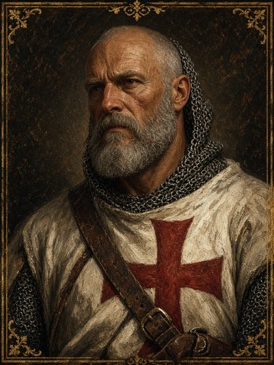
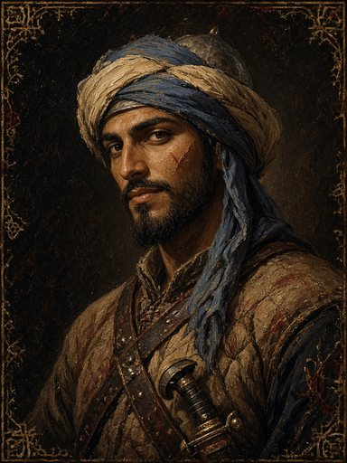
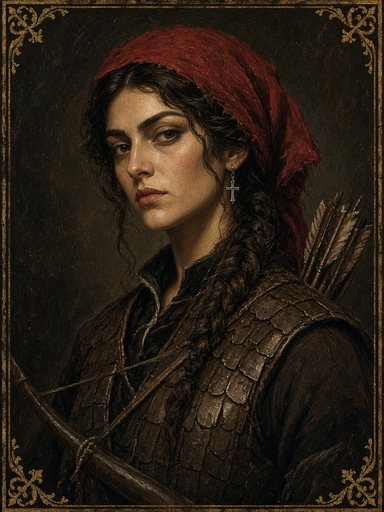
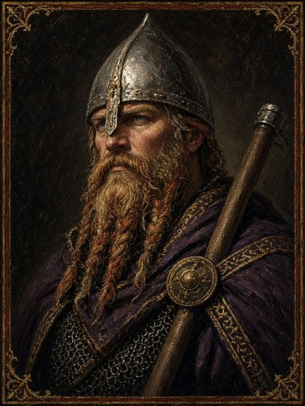
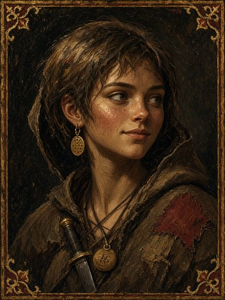
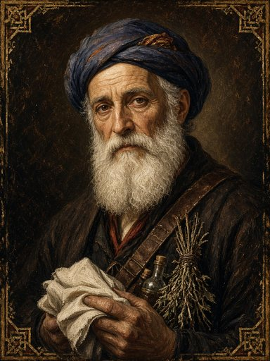

# Companion concepts: PITCH, not decided

> **Status:** a pitch for Cletus to pick **2–3** from (Stage 2, see [ROADMAP](ROADMAP.md)). Nothing here is in the game, and nothing here locks the story.
> Names, backstories and hooks are deliberately loose. The portraits are generated concept art for mood only; the art style is still open.
> Contact sheet: `docs/companions/*.jpg` (full-size originals stay outside the repo).

**Ground rules**
- These are BG-style **set companions**: fixed name, class and story, and they join the **player-made hero**.
- **Joining comes out of play, not a menu.** Each one is tied to a battle, and *what you do in that fight* decides whether they join: who you protect, who you spare, where you stand. If you miss them, they're gone, or they come back later in another form.
- Classes are the existing four from `CONFIG.roles`: Knight, Sergeant, Archer, Scout (`skirmisher`). One concept (**Ishaq**) proposes a **new class** and is clearly flagged.
- **Traits are trade-offs, not power.** Every pro comes with a con you'll feel on the map.
- **Room for mythology:** a few hooks point at relics and folklore (djinn, saints' bones) without committing to them.

| | Companion | Class | Origin | Tone | Joins by… |
|---|---|---|---|---|---|
| 1 | Brother Renaud | Knight | Frankish Templar | stern, devout | keeping him alive when he's cut off |
| 2 | Yusuf ibn Qasim | Scout | Saracen defector | wry, conflicted | sparing him when he yields |
| 3 | Mariam of Edessa | Archer | Armenian mercenary | sardonic | holding her tower with her |
| 4 | Ingvar Halfdansson | Sergeant | Byzantine Varangian | dry, political | fighting beside his patrol |
| 5 | Wren | Scout | Levant-born Frankish orphan | light, eerie | catching her before the raiders do |
| 6 | Ishaq of Acre | **Physician (NEW)** | Jewish physician | warm, humane | protecting his tent, or not burning it |

---

## 1. Brother Renaud of Troyes, Knight

**Who:** a Templar brother near sixty, one of the oldest men still in the saddle. He keeps the Rule to the letter: silence at meals, no retreat unless outnumbered three to one, and confession every week whether he needs it or not. He is kind in private and terrible in public.

**How he joins:** in a fight at a breach or a ford, Renaud starts **cut off** among the enemy with a few HP missing. If he is alive at the end of the battle (because you pushed toward him, Bashed foes off him or pulled them away), he joins. If he falls, he dies, and his sword shows up later on an enemy captain.

**Trait: *Under the Rule***
- **Pro:** +2 DEF while adjacent to another Templar (the hero or any brother). His Shield Wall also covers a second adjacent ally.
- **Con:** he **won't move away** from an adjacent enemy (Move only lets him stay or step to tiles that are still adjacent to a foe), and he never Waits while a foe is in reach. He anchors a line well, and you can't pull him out of a bad fight.

**Hook:** he judges the hero by the Rule, and he refuses to share a camp with **Yusuf** ("an infidel who turned once will turn twice").

---

## 2. Yusuf ibn Qasim, Scout

**Who:** a light-cavalry raider from the Jazira who has ridden for three different emirs and outlived all of them. Funny, watchful, homesick for a river he won't name. He fights for whoever is paying, and he's started to hate that about himself.

**How he joins:** he is one of the **Raider Skirmishers** in an early fight. When he drops below about 25% HP he **yields**: he throws down his blade and stops acting. If nobody on your side hits him for the rest of the battle (you can see the danger, since an AI Templar might), he walks over to your side when the battle ends. If he's finished off, that's the end of it, and a brother comes looking for him later.

**Trait: *Turncoat's Eye***
- **Pro:** he knows how raiders fight. While Yusuf can see them, enemy units within 4 tiles **show their intended target** on the map.
- **Con:** **he won't strike a yielding or fleeing raider** (no attacks on enemies below 25% HP). He also takes −10% hit against units of his old band if a later story ties them in.

**Hook:** he keeps an old debt with **Mariam**'s family. Renaud wants him gone, and the hero has to decide whether that's Renaud's call.

---

## 3. Mariam of Edessa, Archer

**Who:** an Armenian whose family lost everything when Edessa fell. Now she hires out her bow to whichever lord is losing least. She's sharp-tongued and practical, and only pretends not to care. She keeps a ledger of what every side owes Armenians.

**How she joins:** a defence map where she already holds a **watch-tower** as a green (allied AI) unit. If the tower is still yours at the end (no enemy standing on its top tiles), she joins "for now, at a price." If raiders take the tower, she slips away and may show up later on the other side as a sniper.

**Trait: *Paid by the Height***
- **Pro:** +1 max range and +10% crit when she shoots from **2+ levels above** her target, which turns Plunging Shot into her signature move.
- **Con:** **−15% hit when an enemy is adjacent** (no melee nerve), and she's the lowest-HP archer. She needs a guard.

**Hook:** she and **Renaud** argue about whose land this is, and she wants the hero to pick a side.

---

## 4. Ingvar Halfdansson, Sergeant

**Who:** a Varangian Guardsman of the Byzantine emperor, posted "to observe" the Latins. He is polite, unreadable, and carries **sealed orders** he won't discuss. He has been in the East long enough to pray in Greek and swear in Norse.

**How he joins:** a three-way fight where his small Byzantine patrol (green AI) is also fighting the raiders. If your side **doesn't harm his men** (watch your shoves and arrows) and at least one of them survives, he attaches himself to your company when it ends, "on the emperor's business." If you hurt them, he leaves, and Byzantium remembers.

**Trait: *Wall of Axes***
- **Pro:** his **Brace catches two foes** instead of one, and Hook pulls through ally-occupied lines.
- **Con:** heavy Varangian mail gives **JUMP 1 instead of 2** and −1 MOV on sand. He is also loyal to the emperor first; a later choice can make him leave, taking his gear with him.

**Hook:** his sealed orders are about **a relic** the hero may find (mythology door). He is quietly courteous to **Ishaq**, which nobody can explain.

---

## 5. Wren, Scout

**Who:** a Levant-born Frankish orphan, about fifteen, who has lived off armies' leftovers her whole life. Cheerful, quick, and a liar on principle. She swears the ruined places talk at night, and sometimes she's right.

**How she joins:** she darts between the lines **stealing from the baggage wagon** (a neutral unit that moves on its own). If the hero, or any of your units, **ends a turn next to her first**, she's caught and talks her way into joining. If a raider reaches her first, she goes with them, and she might be the one who opens a gate for you, or against you, later.

**Trait: *Light Fingers, Light Feet***
- **Pro:** +1 MOV over rubble and walls. After each battle she **finds something** (extra supplies, small loot). Once per battle she can **swap places** with an adjacent ally.
- **Con:** the frailest unit in the game (low HP and DEF). She **bolts** if she ends a turn next to two or more enemies: she runs 2 tiles away on her own.

**Hook:** she says the clay amulet she stole "**hums**" near certain ruins (djinn/relic hook). She adores **Ingvar**, who pretends not to notice.

---

## 6. Ishaq of Acre, Physician (**NEW CLASS: flagged, needs Cletus's OK**)

**Who:** a Jewish physician from Acre who has stitched up Franks, Saracens and Greeks without asking whose side they were on. He's warm, stubborn and tired. He travels with the company because the company keeps making wounded people.

**How he joins:** a fight around a **field hospital tent** where he is a neutral non-combatant. If **no unit fights within 2 tiles of the tent** (both sides' AI respect it unless forced), and you don't push the fight into it, he follows you when it ends. If the tent burns or he's hurt by your side, he won't come.

**Proposed class: *Physician***
- MOV 3, JUMP 1, very low ATK, average SPD. Abilities: **Bind Wounds** (heal an adjacent ally) and **Steady** (remove Pin/Exposed).
- This is new; the other five fit the existing four classes.

**Trait: *Oath of Healing***
- **Pro:** at the start of his turn he heals **every adjacent wounded unit** a little. Units he treats between battles carry less damage into the next fight.
- **Con:** "every adjacent wounded unit" **includes enemies**, and he **never attacks**. Place him badly and he's patching up the raider you were trying to kill.

**Hook:** he treated **Yusuf** once, years ago, on the other side of a war. He asks the hero, gently, what all of this is *for*.

---

**Picking 2–3:** for contrast in a first test, one blunt pair is **Renaud + Yusuf** (built-in friction, and both joins come from choices in a fight). Add **Mariam** or **Wren** for a third: Mariam fits the current maps' height, and Wren is pure positional mischief. **Ishaq** is the most interesting design but costs a new class.
